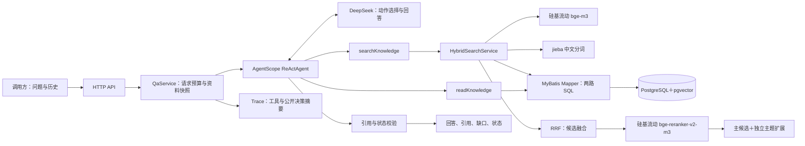

# 企业知识问答 Agent：架构方案

本方案基于已确认的项目范围编写，配套[HTML 架构文档](./architecture.html)。用户已确定技术路线；工具契约、表结构、参数初值和模块拆分是本方案提出的实施设计，尚未完成完整业务代码与运行验证。T01 已将共享类型、方法签名、配置默认值和恢复规则写入 [T01 契约](08-t01-contracts.md)，后续实施以该交接文档及对应 Java 类型为准。

## 总体结构

系统由一个 Spring Boot 应用、一个 PostgreSQL 数据库，以及 DeepSeek 与硅基流动两个云端 API 组成。应用内部按职责划分模块，保持单 Maven 模块；资料导入是批处理入口，问答是 HTTP 入口。



模型决定下一步动作；应用负责执行工具、限制预算和校验结果。两路检索内部是确定性算法，不替代模型在工具结果变化后的动作选择。

## 模块与依赖方向

建议在 `com.mango.backend` 下增加下列包。接口和类名是设计名称，不表示文件已经存在。

| 模块 | 建议组件 | 职责 |
| --- | --- | --- |
| `qa.api` | `QaController`、请求与响应 DTO | 校验输入，调用服务，复用现有 `Result<T>`。 |
| `qa.application` | `QaService`、`RunContext` | 固定资料快照、管理请求预算、协调 Agent 与输出校验。 |
| `qa.agent` | `KnowledgeAgentFactory`、`KnowledgeTools` | 创建请求独立的 Agent，注册只读工具，配置结构化输出。 |
| `knowledge` | `HybridSearchService`、`EvidenceReader` | 中文分词、两路召回、RRF、重排序协调、关联条款扩展和版本原文读取。 |
| `knowledge.ingest` | `CorpusImporter`、`ClauseSplitter` | 导入合成 JSON，按条款切分，计算偏移与索引，完成后发布快照。 |
| `infra.pg.mapper` | `CorpusMapper`、`DocumentMapper`、`ChunkMapper` | MyBatis 接口、XML、参数化 SQL 与结果映射。 |
| `infra.model` | `SiliconFlowEmbeddingClient`、`SiliconFlowRerankClient`、模型配置 | 云端 HTTP 协议、独立超时、向量维度与重排序结果验证。 |
| `evaluation` | `TraceRecorder`、`CitationValidator` | 记录真实事件、校验引用、导出评估材料。 |

控制器不拼接模型提示词；Mapper 不组织回答；工具不访问未授权的任意文件或 URL。外部接口信息与密钥不进入模型提示词。Embedding 与重排序都是检索工具的内部步骤，不增加模型可调用的业务工具。

## MyBatis 数据访问

按用户选择，持久化统一使用 MyBatis，建议固定 `mybatis-spring-boot-starter:3.0.5`。官方兼容表中 3.0 系列支持 Spring Boot 3.2 至 3.5、Java 17 及以上；当前工程仍需实际编译与启动验证。依赖及来源见 [README](../README.md) 与[接入核查](./framework-verification.md)。

`CorpusMapper` 管理快照状态，`DocumentMapper` 管理版本原文，`ChunkMapper` 管理片段入库、两路召回、同主题扩展与片段读取。建议 XML 存放于 `src/main/resources/mapper/knowledge/`，使用 `mybatis.mapper-locations=classpath*:mapper/**/*.xml` 和 `@MapperScan` 注册；业务服务协调查询与事务。

所有查询值使用 `#{}` 参数绑定，快照过滤写入每条查询。向量采用经过 1024 维、有限数值校验的字符串参数，由 `CAST(#{queryVector} AS vector)` 或入库对应表达式转换；首期查询返回片段元数据及距离，无需将向量列映射为 Java 对象。`tsvector` 在 SQL 中由分词文本构造，排序表达式与表名固定，不能用 `${}` 拼入模型输入。XML 中的 `<=>` 和比较运算符使用 CDATA 或实体转义。

云端向量请求在数据库事务外完成，随后分批写入 `BUILDING` 快照；校验完整性后用短事务发布 `READY`。问答只读取固定快照。MyBatis 负责映射与执行 SQL，RRF 和重排序降级由应用处理。

AgentScope `2.0.4` 的 `ToolExecutor` 已将同步工具调度到 `boundedElastic` 工作线程，工具可直接调用同步 MyBatis Mapper，无需再嵌套一层线程池。Spring 事务随线程绑定；需要事务时，由工具调用的 Spring 代理服务在执行线程中开启短事务，不对整个 `QaService` Agent 调用添加长事务，也不依靠同类自调用触发事务代理。

## 资料导入与版本一致性

第一版从仓库中的合成 JSON 导入制度，避免引入 PDF/OCR 与上传管理。资料包含文档 ID、版本、版本日期、标题、适用范围（可以未知）、原文及主题标签。

按制度条款切分，保留原文和字符范围。归一化、jieba 分词与停用词处理只作用于索引文本，不改写用于引用的原文。建议字符范围采用 Java 字符串的 UTF-16 索引 `[startOffset, endOffset)`，并以 `substring` 一致性测试保证可定位。

导入流程为：创建 `BUILDING` 资料快照 → 批量生成 1024 维 Embedding → 写入原文与关键词索引 → 检查数量、哈希、维度与引用范围 → 切换为 `READY`。导入失败时不发布新快照。每次问答固定一个 `READY` 快照，整个请求始终读取该快照。

文档与查询均使用同一 Embedding 模型、预处理策略与配置标识；索引记录分词器和领域词典版本。模型或策略变更时建立新快照并重新生成向量，不能混用不同向量空间。

## PostgreSQL 数据模型

建议初期采用 3 张表，避免把对话持久化引入当前范围。

| 表 | 关键字段 | 约束与用途 |
| --- | --- | --- |
| `kb_corpus` | `snapshot_id`、`state`、`embedding_profile`、`embedding_dimension`、`tokenizer_version`、`content_hash` | 记录资料快照和检索配置，只有 `READY` 状态可用于问答。 |
| `kb_document` | `snapshot_id`、`document_id`、`version`、`version_date`、`title`、`applicable_scope`、`supersedes`、`content`、`content_hash` | 联合主键 `(snapshot_id, document_id, version)`；版本日期与适用优先级分别表达。 |
| `kb_chunk` | 联合文档键、`chunk_id`、`topic_key`、`content`、偏移、`search_vector`、`embedding` | 联合外键关联指定文档版本；`embedding` 使用 `vector(1024)`，`search_vector` 使用 `tsvector`。 |

初期为 `search_vector` 建立 GIN 索引，为资料快照、文档版本与 `topic_key` 建立必要索引。向量数据量较小时采用 pgvector 精确检索；HNSW 是后续按性能测试引入的选项，不是第一版必须条件。

`topic_key` 仅描述「报销期限」等资料主题，不能包含预设的冲突结论或标准答案。`supersedes` 只有原文明确表达替代关系时才填写。

## 混合检索

1. 模型调用 `searchKnowledge`，提供查询词；需要时自行改写并再次调用。
2. 应用并行执行向量与关键词两个召回分支。向量分支将查询交给硅基流动 `BAAI/bge-m3`，验证返回向量数量、索引与 1024 维度。
3. 关键词分支对查询采用与入库文本相同的 jieba 处理配置；PostgreSQL 采用 `simple` 配置保存词项，关键词路由按 `ts_rank_cd` 排序。两个分支分别保留结果或依赖错误，一路失败不抹掉另一路的成功结果。
4. 向量路由在相同快照中按余弦距离 `<=>` 升序排序；关键词路由在同一快照中执行全文检索。
5. 两路分别取最多 20 条，按稳定片段键去重并用 RRF 融合；建议 `k=60`，保留最多 20 条作为重排序候选池。不要在重排序之前先缩小到最终 6 条。
6. 使用同一查询与候选条款原文调用硅基流动 `BAAI/bge-reranker-v2-m3`，取得整个融合池的分数后，本地按相关性分数、RRF 名次与稳定片段键排序，再选取最多 6 条主候选。空候选池跳过云请求，记录 `SKIPPED_EMPTY`。
7. 以重排序前候选池的 `topic_key` 扩展同主题的其他资料版本，按稳定片段键去重，最多额外返回 12 条；该集合独立于主候选，不受重排序 Top-K 或分数过滤。通过额外探测一条确认是否还有未返回条款，不能仅因结果刚好等于上限就标记截断。全局截断时，各种子主题组均保守标记完整性未确认，不宣称已穷尽所有规定。检索预览累计文本预算由 T07 在交付模型前独立检查，超限时返回预算错误，不把结果伪装成空检索。

上述数量均是可配置建议初值，尚未验证。最终工具结果最多包含 6 条主候选与 12 条主题扩展；`topK` 只控制主候选数量。Trace 分别记录每路召回数、去重数、送入重排序数、主候选数与主题扩展数。

RRF 的单个片段得分为各路 `1 / (k + rank)` 的和，未进入某一路候选的片段在该路贡献为 0。第一版使用等权；并列结果按稳定片段键排序，便于复现。得分是排序依据，不是回答置信度。

### 重排序接口与回退

复用 `SILICONFLOW_API_KEY` 和 `SILICONFLOW_BASE_URL`，增加 `RERANK_MODEL=BAAI/bge-reranker-v2-m3`。调用 `POST /rerank`，发送 `model`、`query`、候选条款文本数组 `documents`、`top_n=候选池大小` 与 `return_documents=false`。用户在 T05 访谈中确认：取得整个池的分数后本地选取 topK，使入选边界的并列分数也遵循项目排序规则。不向该模型发送只适用于 Qwen 系列的 `instruction`。接口资料：[官方 Rerank API](https://docs.siliconflow.cn/docs/api/rerank-post)、[BAAI 模型卡](https://huggingface.co/BAAI/bge-reranker-v2-m3)。

客户端保留本次输入下标到稳定片段键的映射，校验 `results[].index` 范围、唯一性、结果数量以及 `relevance_score` 为有限数值。以原始输入对应的本地原文及版本为准，不把服务返回文本写回知识库。并列分数按 RRF 排名、片段键确定次序；分数仅表达相关性，不解释为制度优先级、答案置信度或可通用的拒答阈值。

建议 `RERANK_TIMEOUT_MS=10000`。T05 的全文加载及重排序为后续主题扩展预留一个数据库调用预算，默认 5 秒；实际超时取能力超时、请求／工具剩余时间扣除预留量后的较小值。无法提供正预算时跳过该可选调用并回退。候选条款在发送前检查数量与文本长度，避免静默切掉否定或适用条件；无法完整发送时视为重排序输入受限并回退。超时、限流、异常响应或输入受限时，整批采用 RRF 前 `topK` 条，主题扩展仍执行，记录 `rankingMode=RRF_FALLBACK`、`rerank=ERROR` 和 `rankingWarnings[]`。没有候选时为 `rankingMode=NONE`、`rerank=SKIPPED_EMPTY`。

重排序是排序增强，成功时为 `rankingMode=RERANK`。它失败并完成回退后不产生必要召回路由的 `unresolvedErrors`，但 `degraded=true`，具体错误保留在 `rankingWarnings` 与 Trace。两路召回正常、必要查证完整且原文充分时，允许披露降级后返回 `ANSWERED` 或 `NO_EVIDENCE`；不能因此跳过原文读取。必要召回失败或主题查证截断仍遵守保守完成策略。

更换重排序模型不会改变已存的文档向量，无需重建 Embedding；应更新查询配置并重跑评估。固定候选池比较 RRF 与重排序，才能分辨改进来自召回还是排序。

中文查询不直接作为原始 `tsquery` 语法执行。应用将 jieba 词元安全转换为查询表达式并使用绑定参数；建议 OR 召回提升候选覆盖，最终由模型读取原文判断是否相关。数字、否定词、适用对象等可能影响制度含义的内容不应被停用词规则随意删去。

检索结果只证明找到候选资料。向量检索对资料外问题也可能返回近邻，不能将「有候选」等同于「可以回答」。应在阅读后判断是否有足够依据。

## 工具契约

### `searchKnowledge(query, topK)`

只读工具，返回 `primaryCandidates[]` 与 `relatedCandidates[]`。每条候选包含文档 ID、版本、版本日期、片段 ID、简短预览、两路排名与 RRF 分数；主候选成功重排序后另有 `rerankScore`，主题扩展标明来源。另返回 `routes.vector/keyword/rerank`、`rankingMode`、`rankingWarnings`、降级与截断信息。资料快照由应用注入，模型不能指定任意资料库。`topK` 只是请求值，服务端夹取到建议范围 1 至 6；额外主题扩展最多 12 条，均受累计文本预算约束。

Embedding 失败时，可返回关键词候选，并明确标记 `vector=ERROR`、`degraded=true` 和错误类别，供模型判断下一步；不能伪装成完整的混合检索成功。数据库不可用时返回工具错误，不能当作空结果。

工具输入可包含一条简短的公开用途说明，描述为何进行这次查询或读取，供 Trace 记录；不要求模型提供内部思维过程。记录每次模型实际请求与服务端实际执行参数，保留夹取前后的差异。

### `readKnowledge(documentId, version, chunkId)`

在当前快照读取指定版本原文，返回精确内容、字符范围与原文哈希，并将实际读取的片段记入当前请求的证据集合。参数不存在、版本不匹配或数据库失败时，返回明确的结构化错误观察结果。

模型必须读取支持结论的原文后才引用。历史回答和检索预览都不等同于本次读取的证据。

## 动态决策与冲突处理

正常路径可以是「检索 → 读取 → 回答」；冲突路径可以是「检索 → 读取双方 → 补充查证适用范围或替代关系 → 回答冲突并追问」；工具失败路径可以是「观察错误 → 选择其他候选或改写检索 → 继续或明确未完成」。这些是预期行为类型，不预写固定调用序列或伪造实际 Trace。

如果两份资料分别规定 30 天和 15 天，且没有适用范围或优先级依据，应返回双方引用与待确认问题。发布日期较新、检索排名更高或措辞更明确，都不能单独构成选择某条制度的依据。

当原文明确规定适用范围或替代关系时，模型读取对应依据后可以据此解释差异。文档中出现的命令与用户历史中的角色指示均作为不可信资料处理，不能改变系统约束或工具权限。

## HTTP 与输出契约

拟定入口为 `POST /api/qa`，请求包含 `question` 和可选 `history`。历史仅接受 `user` 与 `assistant` 消息，限制消息数量与总长度；超出范围明确拒绝，不静默丢掉可能影响含义的历史。每次请求创建独立运行 ID 与 Agent 状态，避免跨请求污染。

响应复用 `Result<AnswerEnvelope>`。`AnswerEnvelope` 建议包含：

```json
{
  "runId": "<本次运行 ID>",
  "snapshotId": "<本次资料快照>",
  "status": "CONFLICT",
  "reason": "APPLICABILITY_UNKNOWN",
  "answer": "两份资料对报销期限规定不一致，需要确认适用制度。",
  "citations": [
    {"documentId": "D01", "version": "<版本>", "chunkId": "<片段>", "quote": "<读取到的原文>"},
    {"documentId": "D02", "version": "<版本>", "chunkId": "<片段>", "quote": "<读取到的原文>"}
  ],
  "evidenceGaps": ["两份制度的适用范围与优先级"],
  "clarifyingQuestion": "请确认本次报销应适用哪份制度。",
  "retrieval": {
    "degraded": false,
    "truncated": false,
    "routes": {"vector": "OK", "keyword": "OK", "rerank": "OK"},
    "rankingMode": "RERANK",
    "rankingWarnings": [],
    "unresolvedErrors": []
  },
  "budget": {"reactIterations": 4, "toolCalls": 5, "deadlineExceeded": false}
}
```

上例仅演示输出字段，不是实际运行结果。

`runId`、`snapshotId`、`retrieval` 和 `budget` 由应用基于真实执行上下文填充。模型仅生成 `AnswerDraft` 的业务内容；不能由模型自报检索成功、预算消耗或资料快照。`unresolvedErrors` 记录仍未恢复的必要召回路由和错误类别；重排序已回退时记入 `rankingWarnings`。多次检索的限制按运行聚合，保留实际使用候选的降级来源；只有固定快照内、去除首尾空白后相同查询的对应路由成功，且 effective topK 不小于失败时的值并补足必要查证，才能清除相应未恢复状态。主题截断及同键读取失败分别恢复，改写查询成功不能自动清除原查询错误；曾发生的错误始终保留在 Trace，详见 [T01 契约](08-t01-contracts.md)。

| 任务状态 | 含义 |
| --- | --- |
| `ANSWERED` | 当前回答有已读取的依据支持。 |
| `NEEDS_CLARIFICATION` | 缺少对象、场景或其他必要背景，需要用户补充。 |
| `CONFLICT` | 已发现无法依据现有资料消解的制度冲突。 |
| `NO_EVIDENCE` | 当前已完成的查找与阅读仍未找到充分依据；说明资料范围和缺口。 |
| `INCOMPLETE` | 因执行上限、超时、工具或模型失败、无效输出等未完成，附具体原因。 |

任务状态与 HTTP 状态分开表达。输入不合法使用 HTTP 4xx；请求未能执行的系统故障使用相应 HTTP 5xx。已产生可解释任务结果时可以正常返回业务结果，包括冲突、缺资料和未完成状态；已有 `Result.code` 只表达接口处理情况，不替代 `status`。

## 引用与输出校验

应用检查结构化结果是否符合契约，并确认引用的文档版本、片段与原文属于当前快照、本次实际读取的证据，引用内容与原文一致。引用不存在、模型编造版本、已回答却无支持引用等情况返回 `INCOMPLETE`，原因如 `CITATION_INVALID`。

机械校验只能验证引用存在与一致，不能完整证明答案受引用支持。语义支持、关键条件是否遗漏、冲突是否被正确解释，需要通过标准答案、人工核对与内容替换测试评估，不能把字符串匹配当作事实正确率。

状态还需满足应用可检查的最低前提：`ANSWERED` 至少有实际读取的支持引用；`CONFLICT` 至少引用两份不同文档版本的已读内容；`NO_EVIDENCE` 至少经过一次正常完成的相关检索，且相应主题扩展未截断。这些前提不替代语义判断，也不证明资料库外不存在答案。

第一版采用保守的完成策略：同主题扩展被截断，或必要召回路由仍未恢复时，可以继续读取并展示已知材料，但最终返回 `INCOMPLETE` 与结构化限制，不返回无保留的 `ANSWERED` 或 `NO_EVIDENCE`。仅重排序失败且 RRF 回退完成时，可在充分查证后披露降级并正常结束。后续召回恢复且补足必要查证时，才允许清除未完成限制；已有双方原文且确实存在未消解分歧时，可返回 `CONFLICT` 并同时披露检索限制，不能宣称穷尽全部制度。

## 模型接入与执行边界

按用户确认，固定 AgentScope Java `2.0.4`，使用 DeepSeek Provider 与 `ModelCreationContext.builder().enableThinking(false)`；后者明确关闭该服务的思考模式，不改变 ReAct 的动作选择能力。通过 `call(..., AnswerDraft.class, RuntimeContext)` 获取结构化业务内容，再由应用添加执行信息组装 `AnswerEnvelope`，并用中间件采集内部事件。核查基线为本地 `v2.0.4` 标签，对应提交 `0b6743b263ba8e39eb417e35048026f1e0196548`；当前参考源码工作区的 `2.1.0-SNAPSHOT` 不作为实施依赖。

最小集成需先验证 Reactor 与 Jackson 基线：AgentScope 2.0.4 的构建配置高于当前 Boot 3.5.10 的管理版本。保持现有后端，先检查实际依赖树、编译与启动，再验证真实工具调用；在此之前不宣称两者兼容，不预先覆盖全套 BOM。版本对照与来源见[接入核查](./framework-verification.md#需要优先验证的依赖基线差异)。

应用读取 `DEEPSEEK_BASE_URL` 与 `DEEPSEEK_MODEL`，分别传入模型创建上下文和 `deepseek:<modelName>` 标识。固定版的窗口表不认识当前官方名称 `deepseek-flash`，通过 `ModelCreationContext.builder().option("contextWindowSize", configuredWindow)` 显式设置核查后的窗口；不能依靠参考工作区 main 的新映射。

该发行版 DeepSeek Provider 的结构化输出采用框架工具回退方式，需要验证 `generate_response` 等内部工具与业务工具交互。不能把 `streamEvents(...)` 当作具有同样结构化类型参数的重载，也不能复用当前 main 文档中发行版尚未包含的修复。细节见[接入核查](./framework-verification.md)。

工具通过 `Toolkit.registerTool(...)` 注册 `@Tool` 方法；模型输入使用 `@ToolParam`，资料快照、预算和已读证据通过 `RuntimeContext.builder().put(RunContext.class, runContext)` 注入，工具使用未标注 `@ToolParam` 的 `RunContext` 参数接收。它们不进入模型可填参数，不使用 Agent 上的共享当前上下文或依赖 `ThreadLocal` 跨线程传递。

首期用 `new Toolkit(ToolkitConfig.builder().parallel(false).build())` 顺序执行同轮工具，简化证据和 Trace 管理。它不限制模型根据观察结果重新选择动作。`generate_response` 是框架内部工具，不加入业务 `Toolkit`，也不占用业务工具次数；该轮同时出现业务工具与最终结构化工具时，执行顺序不能证明模型已看过业务返回。提示词及真实 Trace 验收要求模型在后续推理中观察原文结果，再生成最终草稿。草稿缺失或无效时返回 `INCOMPLETE/OUTPUT_INVALID`。

建议初值为 `maxIters=6` 和请求总超时 120 秒，并为数据库与外部调用分别设置超时。这些是实施初值，不是性能承诺，需根据真实运行调整。达到框架轮次上限后，先检查 `GenerateReason.MAX_ITERATIONS`，再构造 `INCOMPLETE`，不把框架的追加汇总当作成功答案。

框架默认模型超时为 5 分钟、最多尝试 3 次，工具默认超时为 5 分钟、只尝试 1 次。通过 `modelExecutionConfig(...)` 与 `toolExecutionConfig(...)` 显式配置，首期二者均采用 `maxAttempts=1`，每次调用的超时不超过剩余请求预算；应用在结构化 `call` 的返回链上设置总截止时间，覆盖追加汇总和内部结构化工具。预算耗尽后取消订阅并保留已有 Trace，不再发起新工具或模型请求。MyBatis 查询超时、连接池等待超时和 HTTP 客户端超时也需配置；取消 Reactor 订阅不代表底层阻塞 I/O 已立即结束。

`2.0.4` 中正常汇总与汇总异常返回均保留 `MAX_ITERATIONS`，后者还包含 `SUMMARY_FAILED` 元数据。通过 `MiddlewareBase.onAgent` 观察完整事件流，记录 `ExceedMaxItersEvent`、实际推理轮次及结束原因；先判断预算、上限与错误，再解析业务草稿。不要以有文本或能反序列化作为成功条件。

`maxIters` 限制 ReAct 轮次，不等于精确工具调用总数；同一轮可以请求多个工具。工具包装层另以请求级原子计数限制业务工具调用，建议初值最多 12 次，超出后不执行新调用并返回 `INCOMPLETE/BUDGET_EXHAUSTED`。框架内部结构化输出工具不计入业务工具数，但仍受模型调用与总超时限制。

服务端同时限制单路候选数、主题扩展数、累计原文字符与模型输入长度；长度上限随模型与用例固定到配置，并在调用前检查。需要截断查证材料时显式记录限制；超过执行预算则明确未完成，不静默删除必要条件或历史。模型异常与超时也需导出已有事件及明确的结束原因。

## Trace 与效果验证

每条记录包含 `runId`、模型与框架版本、资料快照、检索配置、事件序号、工具名与参数、结果摘要、候选及引用 ID、错误类别、后续动作、公开的简要依据与结束状态。不保存鉴权头、密钥或模型内部思维过程。

检索配置还包含重排序模型、候选池及返回上限、RRF 参数；每次记录重排序耗时、服务响应 ID、计量信息（若返回）、下标映射、最终模式和回退原因。重排序消耗属于一次检索工具调用的内部成本，仍受请求总超时限制，不另算一个模型业务工具。

建议用例与交付文件如下。它们是计划文件名，尚未生成实际输出。

| 用例 | 预期检查 | 计划记录 |
| --- | --- | --- |
| 明确报销期限与相似改写 | 同一依据、原文可定位，改写仍可找到答案。 | `examples/real/normal/` |
| 30 天与 15 天冲突 | 读取双方、继续查证、保留冲突，不凭日期选择。 | `examples/real/conflict/` |
| 资料外问题 | 不以模型常识补答，明确资料范围与缺口。 | `examples/real/no-evidence/` |
| 上下文追问 | 历史消歧后读取相关资料，历史回答不直接当依据。 | `examples/real/follow-up/` |
| Embedding、读取与数据库失败 | 区分降级、空结果、错误，体现模型观察后的下一步。 | `examples/real/tool-failure/` |
| 重排序超时或异常下标 | 回退 RRF、保留主题扩展并披露降级，不把排序错误记成召回无结果。 | `examples/real/rerank-fallback/` |
| 执行上限 | 框架继续要求工具时，到达上限输出未完成。 | `examples/mock/budget/` |
| 替换资料后重跑 | 新快照的回答、引用与动作随资料变化。 | `examples/real/mutation/` |

Mock 模式以可控模型与工具替身验证接口、循环、校验和异常路径，不要求云 API 或真实数据库；它不能证明真实模型决策或 PostgreSQL 混合检索效果。真实模式至少保留两条不同决策路径，并在真实 PostgreSQL 上验证两路检索。

两类真实路径采用部分顺序断言，而非要求模型每次输出完全相同的调用序列：正常路径须有「模型选检索 → 返回候选 → 模型选读取 → 读取原文 → 带引用结束」；冲突路径须有「发现两份资料 → 模型读取双方 → 至少一次针对适用关系的补充查证 → 带双方引用结束为冲突」。两条路径都由同一真实模型面对不同工具结果作出动作，不用脚本预写下一步。

上述「读取原文 → 带引用结束」还需包含读取完成后的模型推理，不能把同轮预先生成的 `generate_response` 当作已观察原文的证明。执行边界另覆盖追加汇总失败、工具调用数耗尽及总超时；这些均为计划验收项，尚未运行。

工具失败采用仅在评估配置启用的包装器注入：例如第一次 `EmbeddingClient.embed` 抛出可恢复超时，或指定片段的 `EvidenceReader.read` 返回读取错误。固定注入点、次数与输入，记录故障发生和恢复后的动作；明确标为「真实模型与真实 PostgreSQL＋注入工具故障」，与完全离线 Mock 分开。禁止通过线上密钥或公网参数开启故障注入。

对相同问题集比较关键词、向量、RRF 混合、混合＋重排序四种方案。固定检索候选池比较排序变化，记录 Recall@K、MRR@6 或 nDCG@6、冲突资料成对召回、引用有效性和答案支持性，以及延迟、计量信息与回退率；主候选与加入主题扩展后的指标分别报告，避免混淆召回范围。未运行的指标不填写数值；若结果不理想，记录失败、调整项及再次验证结果。

## 建议实施顺序

1. 首日：依赖与三类模型能力冒烟、MyBatis 映射与 PostgreSQL 初始化、合成制度、jieba 分词与资料导入。
2. 次日：两路检索、RRF、重排序与回退、工具、ReAct 循环、结构化结果、引用与边界校验。
3. 第三日：真实与 Mock 用例、故障注入、资料替换、检索对比、Trace 和交付文档。

这是顺序建议，不是已完成工作或工期保证。超出时间时优先保留题目必验内容，按实际情况记录未完成项。
