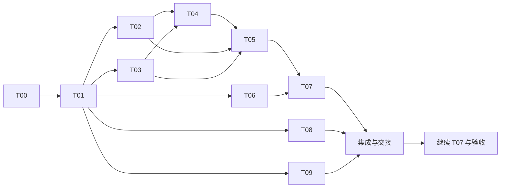

# 企业知识问答 Agent：并行开发计划

## 目标与依据

本计划用于将企业知识问答 Agent 拆分为可由多个开发 Agent 使用独立 Git Worktree 实施的任务。依据为 [HTML 架构文档](architecture.html)、[需求基线](01-requirements.md)、[详细方案](02-solution.md)和[框架接入核查](framework-verification.md)。架构中的接口、表结构和参数属于实施设计；本计划的包名和文件路径是分工约定，具体签名在 T01 中确定。

第一版交付报销和差旅制度问答：HTTP API 接收问题及可选历史；Agent 根据工具结果选择检索、读取、补查或结束；响应包含回答、引用原文、资料缺口和任务状态。使用 Java 17、Spring Boot 3.5.10、AgentScope Java 2.0.4、PostgreSQL／pgvector、MyBatis、jieba、DeepSeek 和硅基流动。暂不开发聊天界面，不保存跨请求会话。

**初始状态：**初始提交为 `a98bcc2f485233d789809681588cf4f6a6298ba0`，保留原有 `master` 历史并从该提交建立 `dev`。T00 已在独立 Worktree 完成忽略规则及交接记录，经子代理审查合并为 `0084c219b33ccdb980e516c3a2b65dd95642316e`，该提交作为 T01 基线。参考源码 `reference-code/agentscope-java` 仅供本地查阅，保留原目录并忽略，不作为普通目录或 submodule 交付；T01 已声明 Maven 依赖、配置绑定和共享契约，具体交接见 [T01 契约](08-t01-contracts.md)。后续执行结果见各任务的实施记录。

**T02 实施结果：**已实现硅基流动 Embedding/Rerank 客户端、严格边界校验、完整响应预算和脱敏错误映射；子代理规范审查未发现问题，契约审查发现的全零向量遗漏已修复并通过定向静态复核，无剩余阻断项。代码、确认决定及交接见 [T02 模型客户端](09-t02-model-clients.md)。未执行编译、启动、依赖树、测试或真实调用；这些仍等待用户指令。

**T03 实施结果：**已实现三表 schema、MyBatis 映射、快照发布与隔离、两路召回、主题扩展及原文读取。两名子代理静态审查发现的空关键词连接和未发布快照读取问题已修复并完成定向复核，无剩余阻断项。按用户指令合并到 `dev`，合并后清理 T03 任务及临时集成 Worktree；交接见 [T03 数据持久化](09-t03-persistence.md)。未执行编译、启动、测试、初始化脚本或真实数据库验证，仍等待用户指令。

T02、T03 上述“等待用户指令”仅表示任务交付时的状态；后续完整测试已覆盖当前合并代码，实际结果见[用户授权后的验证计划](#用户授权后的验证计划)。

**T04 实施结果：**已实现三组完整合成资料、严格 JSON 导入边界、条款切分与原文偏移／哈希、共享 jieba 分词、非 Web 命令行导入入口及完整导入后发布。子代理完成规范、契约审查及定向复核，错误诊断与创建标记等问题已修复，无剩余阻断项；设计、审查及交接见 [T04 资料与导入](t04-ingestion-design.md)，操作说明见 [资料目录](../data/README.md)。T05 可复用已实现的 `KnowledgeTokenizer`。

T04 已以 `cc0a4d9` 合并到 `dev`，任务 Worktree 已删除，任务分支保留。用户授权后完成编译、48 个测试、打包、PostgreSQL／pgvector 初始化、三组资料导入、自定义词典和失败隔离验证；外部 Embedding 使用本地受控服务，真实模型仍未验证。运行测试发现重复 JSON 字段缺少行列位置，修复以 `d0c70d4` 合并。完整证据见 [T04 运行验证](t04-ingestion-verification.md)。

**T05 实施结果：**已实现内部并行的两路召回、等权 RRF、全融合池重排序后本地选 topK、整批回退、单次主题扩展、保守截断标记及原文证据登记；可选排序为必要主题扩展预留时间，双路失败保留两条错误供后续补查。两名子代理完成规范与契约静态审查，重复校验、共享线程池饥饿及踩坑文档表述问题已修复并复核，无剩余阻断项。交接见 [T05 检索与读取](t05-search-design.md)，并发注意事项见 [T05 踩坑记录](pitfalls/T05-nested-blocking-scheduler.md)。用户授权后完成 48 个既有测试、45 项逻辑验证、26 项 PostgreSQL 集成验证和打包，未发现实现缺陷；随后补充 9 个检索单元、4 个证据读取单元和 2 个 Docker pgvector 集成 JUnit，两名子代理再次完成规范与契约审查并修复断言强度及文档入口问题，无剩余阻断项。新增 15 个测试已于 2026 年 11 月 1 日执行，当前完整测试共 63 个并全部通过。真实模型及完整问答仍待补齐，详见 [T05 运行验证](t05-search-verification.md)。

**T08 实施结果：**已实现 `POST /api/qa`、严格 JSON 与历史边界校验、统一响应、依赖错误映射及 MVC 超时兜底。两名子代理静态审查发现的异常处理范围和字段提示问题已修复并完成定向复核，无剩余阻断项。按用户最新确认，以 `236ea8d` 合并到 `dev`，已删除 T08 任务 Worktree；设计与审查记录见 [T08 HTTP 接口](t08-http-design.md)。首次交付阶段未执行编译、启动、测试或真实接口验证；完整问答仍依赖 T07，HTTP 验证等待用户后续指令。

2026 年 11 月 1 日按用户确认进行 T08 收尾：以 `052bffb` 为基线，子代理静态核对未发现明确的 HTTP 层功能缺口或契约偏差，本轮无需修改生产代码。T08 代码开发已交付；当前基线尚无 T07 服务实现及 HTTP 专用测试类，后续分别由 T07 提供服务 Bean、T09 补齐 HTTP 验证。其他任务的运行记录不能替代 HTTP 验收，本轮未执行编译、启动、测试或接口调用。具体交接条件见 [T08 收尾核对](t08-http-design.md#2026-年-11-月-1-日收尾核对)。

**T07 实施结果：**已实现请求级快照、预算、证据注册与检索恢复聚合，提供 AgentScope 顺序工具、DeepSeek 配置、真实模型循环、输入边界及结果组装；补充生成前已观察证据检查和必填公开用途。两名子代理完成框架接入、业务契约静态审查和定向复核，已修复失败优先级、混合无效引用漏判、参数 Trace、最终预算判定和包装超时分类，无剩余阻断。设计、提交与审查记录见 [T07 Agent 与问答服务](t07-agent-qa-design.md)，执行边界见 [T07 踩坑记录](pitfalls/T07-streaming-budget-and-evidence-observation.md)。按项目流程集成到 `dev` 并清理 T07 Worktree；本轮未执行编译、启动、依赖树、测试或真实调用，运行验证等待合并后的用户指令。

## 执行规则

1. 先整理现有工作区，确认需要纳入基线的代码、文档、忽略项及参考源码处理方式；保留用户现有改动和已有首次提交，建立 `dev` 分支。由集成负责人处理，不让并行任务代为提交或清理。
2. 每个代码任务由对应主代理在独立 Worktree 和独立分支实现。任务完成后调用子代理做代码审查，主代理处理审查问题；审查结束后由集成负责人依次合并到 `dev`，确认合并结果后删除该任务 Worktree。不要删除含未保存改动的 Worktree。
3. 开发阶段不运行测试；合并到 `dev` 后等待用户指令再开始测试。编译、启动、依赖树、真实接口调用与冒烟验证统一列入待授权验证，不作为并行任务的开工或合并门槛。可以进行代码阅读、静态检查和差异审查；不得把它们表述为运行验证。
4. 任务仅修改分配的文件。需要修改其他任务负责的文件时，先向集成负责人提出变更，由负责人协调契约和后续合并；不要在多个分支各自修改公共文件。
5. 遇到技术含量较高的踩坑点时，按「现象、环境、原因和解决方案」写入 `docs/pitfalls/`；文件名带任务编号，避免并行覆盖。未经运行证实的原因标为待验证。
6. 审查发现的问题或依赖不明确时，暂停受影响的交接；已独立的任务可继续。合并冲突由集成负责人按约定的文件归属处理，禁止为了快速合并丢弃其他任务的成果。

## 基线与共享文件

T00 完成后，从 `dev` 创建 T01 Worktree；T01 合并后，其他任务从对应依赖已合并的 `dev` 提交创建 Worktree。任务启动前记录基线 commit；不要多个 Worktree 同时检出同一个分支。集成负责人串行操作 `dev`，并保留任务分支及审查记录直到合并完成。

| 文件或目录 | 唯一负责人 | 约束 |
| --- | --- | --- |
| `pom.xml`、`src/main/resources/application.properties`、`.env.example` | T01 | 所有依赖、配置键及默认值集中登记；其他任务提出变更请求。 |
| `src/main/java/com/mango/backend/contract/**` | T01 | 跨任务 DTO、枚举及方法签名；不是为所有类创建接口。 |
| `src/main/java/com/mango/backend/BackendApplication.java`、现有 `result/**`、`exception/**` | T01 | 尽量复用；需要改动由 T01 或集成负责人统一处理。 |
| `docs/03-evaluation.md`、`docs/04-ai-usage.md`、`docs/05-retrospective.md`、`README.md` | T09 | 合并时如实区分计划和实际结果；个人贡献、实际耗时与验证结果待取得事实后填写。 |
| `src/test/**`、`examples/**` | T09 | 测试和示例由 T09 统一编写；测试执行需另等用户指令，实际输出不得预填。 |

除共享目录外，各任务仅拥有下表指定目录；`src/main/java/com/mango/backend/` 以下简称 Java 根目录。建议包名用于防冲突，可以在 T01 统一调整，但调整后须同步更新分工表。

## 任务与文件归属

| 任务 | 负责范围与独占路径 | 依赖／交付条件 |
| --- | --- | --- |
| **T00 基线与集成** | 集成负责人整理现有 Git 状态、保留初始提交并建立 `dev`；负责所有合并及 Worktree 生命周期。 | 检查实际跟踪内容、参考源码、密钥与本地杂项；不覆盖或丢弃现有改动。此任务不实现业务代码。 |
| **T01 配置与契约** | 共享文件；Java 根目录 `contract/**`；配置项及依赖声明。 | 明确请求、响应、状态、候选、证据、快照、模型返回、错误、预算与 Trace 的类型和调用签名；列出所有跨任务输入输出。只添加真实需要的共享类型；契约定稿合并后再启动依赖任务。 |
| **T02 模型客户端** | Java 根目录 `infra/model/**`。 | 基于 T01 实现硅基流动 Embedding 与 Rerank 客户端、协议和边界校验；处理 1024 维向量、下标和有限分数；按契约传递超时与错误。DeepSeek 的 Agent 配置由 T07 负责。 |
| **T03 数据持久化** | Java 根目录 `infra/pg/**`；`src/main/resources/mapper/knowledge/**`；`src/main/resources/db/**`。 | 基于 T01 提供快照、文档和片段的 schema、Mapper、SQL 及映射；实现固定快照过滤、向量与全文查询、主题扩展和原文读取，查询参数绑定。 |
| **T04 资料与导入** | Java 根目录 `knowledge/ingest/**`；`data/**`。 | 基于 T01、T02、T03 的已合并契约与实现，提供合成制度、条款切分、原文偏移、分词及导入入口；向量请求置于事务外，完整后发布 READY 快照。数据集包含可核查的 30 天／15 天冲突、明确规则和追问资料。 |
| **T05 知识检索与读取** | Java 根目录 `knowledge/search/**`、`knowledge/evidence/**`。 | 基于 T01、T02、T03 的已合并实现，组合向量与关键词召回、RRF、重排序和回退、同主题扩展及原文读取；保留降级、截断和错误状态。 |
| **T06 输出校验与 Trace** | Java 根目录 `evaluation/**`。 | 基于 T01 实现引用与状态的机械校验、执行事件与 Trace 记录；只接受本次快照内已读证据。机械校验不宣称可证明语义支持。 |
| **T07 Agent 与问答服务** | Java 根目录 `qa/agent/**`、`qa/application/**`。 | T01、T05、T06 合并后开始；实现请求级上下文、AgentScope 工具注册、模型动态决策、结构化草稿、执行预算和结果组装。工具只暴露检索与原文读取，运行上下文通过框架注入。 |
| **T08 HTTP 接口** | Java 根目录 `qa/api/**`。 | T01 合并后可开发；依赖 T07 契约接线。实现 `POST /api/qa`、输入及历史校验、统一响应和明确的 HTTP 错误；不得另改共享响应类。 |
| **T09 测试与交付材料** | `src/test/**`、`examples/**`、README 和三份交付文档。 | T01 后可编写测试方案与测试代码，引用已确定契约；业务模块合并后完善。运行测试、生成真实输出与评估结论均等待用户指令，不能伪造运行记录。 |

T04 的导入工具与 T05 的检索必须使用同一分词、词典、Embedding 模型和快照约定。T01 明确共享配置和数据约定；分词实现归 T04，T05 只调用 T04 暴露的已合并能力。因此 T05 开始实现前还需 T04 合并；若需进一步并行，只能由集成负责人先把分词实现及契约独立合并，不能在两个任务中复制实现。

## 并行批次与合并顺序

- **批次 A：**T00 → T01，串行建立工作基线与稳定契约。
- **批次 B：**T01 合并后，T02、T03、T06、T08、T09 可并行。T08 按 T01 定义的问答服务签名开发，不自行创建另一套服务实现；T09 只编写材料与测试，不执行。
- **批次 C：**T02、T03 合并后，T04 开始。T04 合并后，T05 开始。
- **批次 D：**T05、T06 合并后，T07 开始。T08、T09 的收尾可并行，但不得修改 T07 文件。
- **集成：**集成负责人逐个合并任务分支，建议顺序为 T02、T03、T06、T04、T05、T07、T08、T09；同批次顺序可按完成情况调整。合并前审查接口一致性、配置遗漏和冲突；发现跨任务问题时单独建立集成修复 Worktree，按相同审查与合并流程处理。

依赖箭头表示前置任务的成果已合并到 `dev`，而不是只提交在另一个 Worktree。并行任务基于同一基础提交可以避免编辑冲突，但无法保证契约或行为完全兼容；集成审查仍需逐项检查。

## T01 必须冻结的交接契约

本轮定稿的 Java 类型、签名、配置与边界语义见 [T01 契约](08-t01-contracts.md)，任务基线和审查记录见 [T00/T01 交接](07-t00-t01-handoff.md)。运行上下文中的预算、证据和检索聚合由 T07 提供请求独立实现；Trace 记录器及其工厂由 T06 实现。各任务独占目录保持原约定。

T01 的交付需覆盖下列内容，并写明 Java 类型、包路径、方法签名、字段含义、错误传播和调用示例；未定项标记待定，不让下游自行猜测。修改已发布契约时，由集成负责人协调受影响任务和合并顺序。

- **问答：**`question`、仅含 `user`／`assistant` 的可选 `history`；`Result<AnswerEnvelope>`；`ANSWERED`、`NEEDS_CLARIFICATION`、`CONFLICT`、`NO_EVIDENCE`、`INCOMPLETE` 及原因。
- **资料与证据：**固定快照 ID、文档 ID、版本、片段 ID、原文、偏移和哈希；已读证据的登记与查询。日期不自动代表制度优先级。
- **检索：**查询与 `topK` 的服务端约束、候选与同主题版本分组、排名信息、路由错误、排序回退及主题截断；明确恢复后如何更新未解决错误。
- **模型服务：**Embedding 输入输出、批次对应关系与 1024 维要求；Rerank 候选下标映射、超时和失败；请求剩余预算的传递方式。
- **Agent 运行：**请求级快照、预算、已读证据、事件和最终结果的归属；业务工具最多调用次数、模型轮次和总超时独立记录；应用填充运行信息，模型只提供业务草稿。
- **配置与错误：**数据库、模型服务、词典和各超时的配置名；错误与空结果区分；记录中不得包含密钥。默认值与架构建议保持一致，并标明需要后续验证。

T01 不应仅以未实现的方法桩宣布集成完成。每个任务完成后要与真实调用方核对签名；在测试授权前，这只是静态交接检查。

## 任务完成与审查清单

每个开发主代理提交交接内容：任务编号、分支和基线 commit、实现内容、改动文件、公共契约变化、已知限制、子代理审查结论和待集成事项。必要时记录 `docs/pitfalls/<任务编号>-<主题>.md`。交接中明确「未测试」，不得虚构编译、运行或调用结果。

子代理审查至少检查：职责和文件边界、契约一致性、业务条件及错误处理、资源与密钥、对其他任务的影响；重点检查引用是否来自已读证据、冲突是否保留双方、失败是否误判成空结果、快照是否贯穿导入与查询。主代理修复审查发现的问题后再交付合并。是否需要再次审查由问题影响决定。

## 用户授权后的验证计划

T09 已按用户确认的阶段范围编写契约测试、验收输入、标注模板和交付文档，详见 [测试与评估](03-evaluation.md)。用户随后授权测试；当前 48 个既有测试和 15 个 T05 JUnit 均已通过，完整执行共 63 个测试且 0 失败。T04 的本机数据库与受控 Embedding 导入验证、T05 的逻辑级与真实 PostgreSQL 检索读取验证已完成，详见 [T04 运行验证](t04-ingestion-verification.md)与 [T05 运行验证](t05-search-verification.md)。完整离线 Mock 循环、真实模型路径和 HTTP 验收仍待相应实现合并后补齐，不据此将 T09 全部验收项标为完成。

下列内容是剩余验证计划，部分项目已在 T04 范围执行。T09 负责准备方案和测试材料；后续执行者继续记录命令、环境、结果、失败和证据位置。

| 验证层次 | 待验证内容与证据 |
| --- | --- |
| 依赖与框架 | Java 17 目标编译和 JAR 打包已通过；成功 Boot 启动当前因 T07 `QaService` 缺失而失败。Maven 依赖树、AgentScope 真实工具调用和结构化输出仍待验证；特别核查 Reactor／Jackson 基线差异。失败时根据证据调整，不预先覆盖整套 BOM。 |
| 数据与检索 | 63 个测试已覆盖实际 PostgreSQL／pgvector schema、Mapper、快照发布与隔离、中文分词、向量和关键词召回、RRF、重排序及失败回退。事务并发边界和大数据量性能仍待验证。 |
| 核心行为 | 明确答案、30 天／15 天冲突、资料外问题、相似改写、上下文追问、工具失败、执行上限和资料替换；核对引用、状态、降级及未完成原因。 |
| Agent 决策 | 至少两条真实模型路径，记录工具参数、返回摘要、后续动作与公开简要依据；确认读取完成后模型再作决定。Mock 只能验证流程与异常，不证明真实决策或真实数据库检索效果。 |
| 评估与交付 | 至少 3 组真实输入、实际输出和运行记录覆盖正常、资料不足及工具失败，并覆盖全部题目验收点；比较关键词、向量、混合和混合＋重排序，报告实际指标、限制与失败。 |

T04 的验证不能替代 AgentScope 完整问答兼容性或 R01–R10 验收。后续完成验证后，继续更新 `docs/03-evaluation.md`、README、AI 使用记录和复盘；引用 `examples/` 中实际产生的材料。记录实际投入时间及未完成项。
